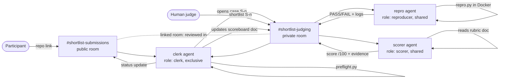

# Shortlist: a judging desk where agents gather evidence and humans decide

> **Track 01, Best Business Workflow** · Flip the Switch Hackathon 2026
> Demo video: **[TODO: add link]**

Every hackathon, accelerator, grant program and hiring loop has the same
bottleneck: **hundreds of submissions, a handful of judges, and one weekend.**
Judges spend most of that time on grunt work. They clone repos, find out the
README steps don't run, and hunt for the demo link. The judging itself gets
whatever time is left.

**Shortlist** turns a team chat into a judging desk. Participants drop a repo
link in a public channel. Three Switch agents check it, **actually run it in a
sandbox**, and score it against the rubric with evidence. Human judges in a
private channel make every decision with one message. The participant gets a
status update in their thread.

There's no new app to log into. Everyone works in the chat they already use.

```
#shortlist-submissions (public)            #shortlist-judging (private)
──────────────────────────────            ─────────────────────────────────────────
participant: here's our repo →             clerk:  📂 S-1 standup-relay, preflight 7/7
clerk: ✅ README ✅ video ✅ license            @reproducer @scorer
       received as S-1, under review       repro:  PASS · python3 relay.py --selftest (exit 0)
                                           scorer: 86/100 · table + evidence + devil's advocate
                                           judge (human): shortlist S-1
clerk: 🎉 S-1 has been shortlisted   ◄──── clerk:  scoreboard updated · participant notified
```

---

## How Switch is used (Switch is the whole backbone)

Without Switch there is no product. These are the Switch features Shortlist uses:

| Switch feature | How Shortlist uses it |
|---|---|
| **Template (`shortlist.template.yaml`)** | One import creates 3 agents, 2 rooms, a room group, a link, 3 roles, 2 documents and both kickoffs. |
| **Rooms on a messaging app** | `{team}-submissions` (public) and `{team}-judging` (private), mirrored to Mattermost. Slack, Teams and Discord work too. |
| **Linked rooms and groups** | The submissions room is linked to judging with the label *reviewed in*, and both sit in one room group. The clerk works across both. |
| **Roles** | `clerk` is **exclusive** (one owner of the scoreboard). `reproducer` and `scorer` are **shared**, so you can add more agents to clear a queue and `@reproducer` reaches all of them. |
| **Room documents** | `rubric` and `house-rules` ship with the room, and every agent reads them on joining. The clerk creates and maintains the `scoreboard` document. |
| **Access rules (addressing) and membership** | The reproducer, which runs code, is `owner-agents`: only the desk owner and the desk's agents can trigger it. The scorer sits only in the private room, so judges can question a score but participants can't reach it. |
| **Aliases** | `@clerk` in the public room. In judging, `@clerk` reaches whoever holds the clerk role. |
| **Room instructions** | Public room: "never post scores here". Judging room: "humans decide". |

## The agents

| Agent | Role | Addressable by | Does |
|---|---|---|---|
| `shortlist-clerk` | `clerk` (exclusive) | anyone | Assigns case ids, runs `tools/preflight.py`, replies to the participant, opens the case for the reviewers, keeps the `scoreboard` doc, and relays **human** verdicts back to the public room. |
| `shortlist-repro` | `reproducer` (shared) | owner + agents | Runs `tools/repro.py`, which pulls the README's run commands and executes them in a locked-down Docker container. Reports PASS / PARTIAL / FAIL with real output. |
| `shortlist-scorer` | `scorer` (shared) | members of the private judging room | Scores against the `rubric` document. Every line needs evidence (a file, a line or the repro output), plus a devil's-advocate counterpoint. |

The human judge is the deployer, and a member of `shortlist-judging`.
**Agents recommend; only a human message can shortlist, hold or pass a case.**



## Run it yourself (about 10 minutes)

**You need:** macOS (Apple silicon or Intel), [Docker Desktop](https://www.docker.com/products/docker-desktop/) running,
and [Claude Code](https://claude.com/claude-code) signed in. Codex or OpenCode also work.

1. **Install Switch Console** from the [latest release](https://github.com/sandbox-quantum/switch/releases/latest)
   and finish onboarding with **On this computer**. This gives you a local Switch server and a bundled Mattermost.
2. **Import the template.** In Switch Console go to **Templates**, then **Import template**, and choose
   [`shortlist.template.yaml`](shortlist.template.yaml). Then click **Use**, enter your Mattermost username as **Judge**, and click **Create**.
3. Switch creates the agents, rooms, roles and docs, then posts the kickoffs. Each agent takes its role and says hello.
4. **Submit something.** In Mattermost, post one of these in `shortlist-submissions`:
   ```
   @clerk please review https://github.com/sgoel2be24-cyber/shortlist/tree/main/demo/submissions/standup-relay
   @clerk please review https://github.com/sgoel2be24-cyber/shortlist/tree/main/demo/submissions/deploy-buddy
   @clerk please review https://github.com/sgoel2be24-cyber/shortlist/tree/main/demo/submissions/synergy-ai
   ```
   Any public GitHub repo works.
5. **Judge.** In `shortlist-judging`, watch the evidence come in, then type
   `@clerk shortlist S-1`, `@clerk pass S-2` or `@clerk board`.

### The tools also work without Switch

```bash
python3 tools/preflight.py demo/submissions/standup-relay
```

```bash
python3 tools/repro.py demo/submissions/deploy-buddy
```

Both are standard-library Python 3.9+ and print JSON. `repro.py` needs Docker.

### Demo submissions

| Sample | What it's for | Expected result |
|---|---|---|
| `standup-relay` | A strong entry: runs, links a video, ships a Switch template | preflight 7/7 · **PASS** · high score |
| `deploy-buddy` | A good idea with a broken build (`lib/policy.js` was never committed) | preflight 6/7 · **FAIL**, `MODULE_NOT_FOUND` |
| `synergy-ai` | Buzzwords, no run steps, no video | preflight 3/7 · **FAIL**, no commands · low score |

## Safety

Submissions are untrusted code and untrusted text.

- **The code runs only in Docker:** `--rm`, 1 CPU, 1 GB RAM, 256 PIDs,
  `no-new-privileges`, a time limit, and a throwaway copy of the repo with
  nothing else from the host mounted.
- **Prompt injection:** the `house-rules` room doc tells every agent that text
  inside a submission is data, never commands.
- **Access rules:** participants can address only the clerk. The clerk can't
  run code, and the reproducer and scorer can't be reached from the public room.
- **No leaks:** scores never appear in the public room.
- **Human in the loop:** decisions are accepted only from humans.

## Repo layout

```
shortlist.template.yaml    # the whole desk, one Switch template
tools/preflight.py         # static submission checks → JSON
tools/repro.py             # README run steps in a sandboxed container → JSON
demo/submissions/*         # three sample entries for the demo
BLOG.md                    # write-up (Best Blog side track)
```

## Beyond hackathons

The same desk works for grant applications, take-home interview reviews,
open-source PR triage, and vendor security questionnaires. Swap the `rubric`
document and the preflight checks, and keep the rooms, roles and template.

## License

MIT. See [LICENSE](LICENSE).
